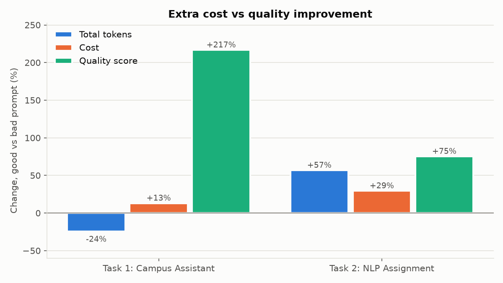

# prompt_structure

## Prompt Structure: обычный промпт против Task → Context → Format → Example

**Цель задания.** Сравнить, как меняется ответ ИИ, если вместо короткого обычного запроса написать промпт по схеме **Task → Context → Format → Example**. Для этого я взял две свои реальные учебные задачи. Для каждой отправил плохой и хороший промпт, сохранил оба ответа полностью и сравнил их.

### Как проводился эксперимент

- Каждый промпт отправлялся в **отдельный новый агент Claude** (Claude Opus 5.5) без истории диалога.
- У всех четырёх запусков **одинаковые условия**: доступ к моим учебным файлам только для чтения, сам промпт и просьба вернуть только ответ. Между запусками меняется только текст промпта.
- Ответы скопированы из транскриптов агентов автоматически, без правок.
- Каждый промпт запускался один раз, так что это небольшой эксперимент, а не статистика.

## Эксперименты

### 1. Подготовка к защите SDU Campus Assistant (Sprint 5 Report)

Источник: настоящий отчёт `SDU Campus Assistant — Sprint 5 Report.docx` (US17–US20: расписание, «где моя следующая пара», список событий, поиск и фильтр). Оба ответа нашли этот отчёт. Плохой промпт дал короткое объяснение и речь **на русском**. Хороший промпт дал полный комплект для защиты:
- разбор всех разделов отчёта;
- 22 термина;
- план выступления;
- речь **на английском**;
- 18 вопросов с ответами на английском и пояснениями на русском;
- честные пометки о том, чего в отчёте нет.

**Результаты:** [results/task-1-campus-assistant.md](results/task-1-campus-assistant.md)

### 2. NLP Assignment 2: классификация описаний книг по жанрам

Источник: мой ноутбук `NLP_Assignment_2_Book_Descriptions.ipynb`, `book_descriptions_labeled.csv` (2061 запись, 4 жанра) и папка `outputs/`.
- Плохой промпт («помоги **выполнить**») превратился в аудит: что не доделано в ноутбуке, плюс собственные новые эксперименты агента.
- Хороший промпт дал объяснение для защиты: TF-IDF, Naive Bayes, train/test и CV, multi-label → single-label, confusion matrix и ошибки. Все числа взяты из моих файлов. Кроме того, ответ поймал важную деталь: NB в ноутбуке работает на CountVectorizer, а не на TF-IDF.

**Результаты:** [results/task-2-nlp-assignment.md](results/task-2-nlp-assignment.md)

## Сравнение плохих и хороших промптов

| | Задача 1: плохой | Задача 1: хороший | Задача 2: плохой | Задача 2: хороший |
|---|---|---|---|---|
| Структура промпта | Одна фраза | Task / Context / Format / Example | Одна фраза | Task / Context / Format / Example |
| Длина ответа | ≈ 9 500 симв. | ≈ 22 500 симв. | ≈ 10 000 симв. | ≈ 17 400 симв. |
| Опора на реальные файлы | Да | Да, источник назван | Да | Да, источник назван |
| Покрыты все нужные темы | Частично: нет плана защиты, мало терминов | Да, все 7 пунктов FORMAT | Частично: нет принципа NB, CV и multi-label почти не разобраны | Да, все 8 пунктов FORMAT |
| Язык речи / вопросов | Русский | Английский + пояснения на русском | Русский | Русский |
| Шаблон из EXAMPLE | — | Применён к US17–US20 (для US19–US20 без «Как рассказать») | — | Применён к TF-IDF, NB, CV |
| Выдуманное / непроверенное | Расшифровка LC&HV подана как факт | Пометки «в отчёте не указано», список «Чего не говорить» | Свои прогоны моделей с числами, которых нет в ноутбуке | Новых экспериментов нет, примерные значения помечены |
| Что полезно только здесь | — | — | Нашёл PDF задания и список недоделок в ноутбуке | Предупреждение: NB работает на CountVectorizer |

## Token Usage and Cost Analysis

**Проведено экспериментов: 2** (4 запуска: Bad и Good для каждой задачи). В задании говорится о 23 экспериментах, но в репозитории их 2, и статистика посчитана только по ним. Токены взяты из реальных полей `usage` API (модель `claude-opus-5-5`). Стоимость посчитана по официальным ценам Anthropic на 2026-11-12. Токены, которые Claude Code потратил на создание репозитория, в анализ не входят.

| Среднее на эксперимент | Bad Prompt | Good Prompt | Разница |
|---|---:|---:|---:|
| Токены самого промпта (Good − Bad, измерено) | — | — | +410 / +463 (≈ +1% входа) |
| Total tokens за запуск агента | 531 501 | 628 902 | +18.3% |
| Output tokens финального ответа | 5 329 | 8 660 | +62.5% |
| Estimated cost за запуск | $0.672 | $0.823 | +22.5% |
| Время генерации финального ответа | 55.4 с | 68.1 с | +22.8% |
| Quality Score (0–10) | 4.2 | 9.5 | +5.3 |
| Cost per quality point | $0.159 | $0.086 | −46% |



**Кратко.**
- Структурированный промпт сам по себе почти бесплатный: около +1% входных токенов.
- Дороже выходит то, что он заставляет сделать: ответ длиннее, а агент читает больше файлов.
- В Задаче 1 токенов стало даже на 24% меньше, а качество выросло втрое. Это явный выигрыш.
- В Задаче 2 расход вырос почти так же, как качество (+57% токенов, +75% качества). Это оправдано, но разница небольшая.
- В абсолютных деньгах Bad Prompt дешевле, а в пересчёте на балл качества выгоднее Good Prompt.

Полный анализ: таблицы по каждому эксперименту, разбивка промпта, все графики и ответы на 8 вопросов — в [results/token-analysis.md](results/token-analysis.md).

## Итоговый вывод

**Format improved the answers the most.** In both experiments almost every new part of the good answer matches one line of my FORMAT list. In Task 1 the English speech, the defense plan, the 22-term glossary and the 18 questions with Russian notes all appeared only because I asked for them. In Task 2 the Naive Bayes explanation, the train/test and cross-validation section and the multi-label section appeared the same way. The bad prompts did not get these parts at all, or got them only in one sentence.

The other parts did not matter equally:

- **Task** mattered a lot in Task 2. One word changed the whole answer: "help me *do* the assignment" gave me a review of my notebook, while "help me *understand and prepare for the defense*" gave me an explanation.
- **Example** gave the answers a clear, repeated structure ("What is it? Why? How does it work? How to explain it?"). The line "do not invent results" made the answers more honest: they marked what is not in the report and did not run new experiments. But the model did not apply the template to every item.
- **Context** had the smallest effect. The model found most of this information in my files anyway, so describing the project again changed less than I expected.

The bad prompts were not useless. Both found my real files, and the bad NLP prompt even found the assignment PDF and listed what I still have to finish. Still, they answered a different question than the one I needed.

My main observation: when I split a request into Task, Context, Format and Example, it is easier for me to remember the important details I would forget in a normal request. For example, I would forget that the speech must be in English, or that I need questions with answers. Writing the Format list made me think about what I actually need for the defense. That is why the structured prompts worked better.

## Структура репозитория

```text
prompt_structure/
├── README.md
├── prompts/                         # тексты 4 промптов
├── scripts/
│   ├── analyze_usage.py             # токены, время и стоимость из транскриптов
│   ├── build_token_report.py        # метрики эффективности, таблицы, графики
│   └── count_prompt_tokens.py       # токены по частям промпта (нужен API-ключ)
└── results/
    ├── task-1-campus-assistant.md
    ├── task-2-nlp-assignment.md
    ├── token-analysis.md
    ├── charts/                      # 6 графиков PNG
    └── data/                        # usage, оценки качества, ответы
```
