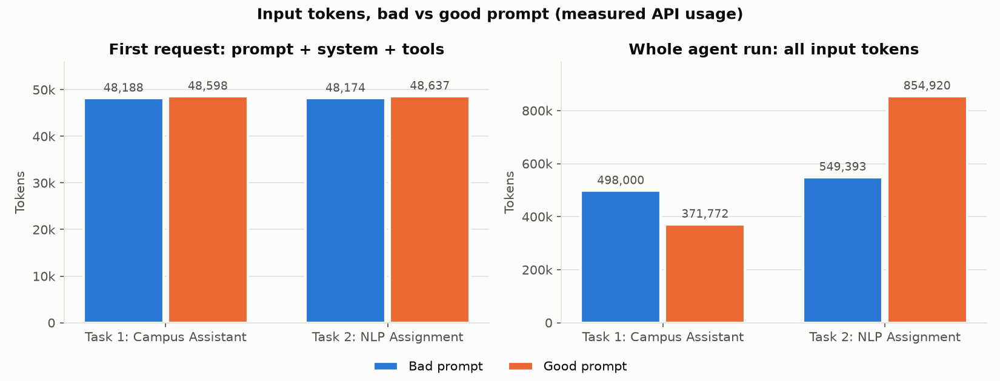
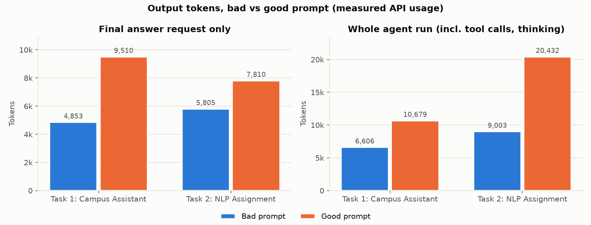
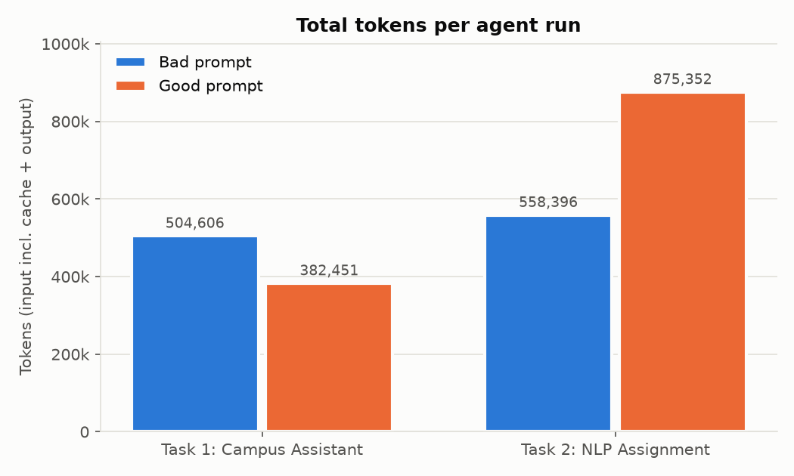
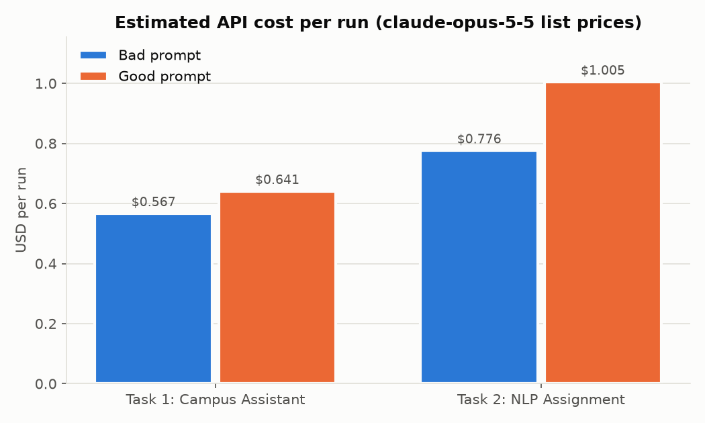
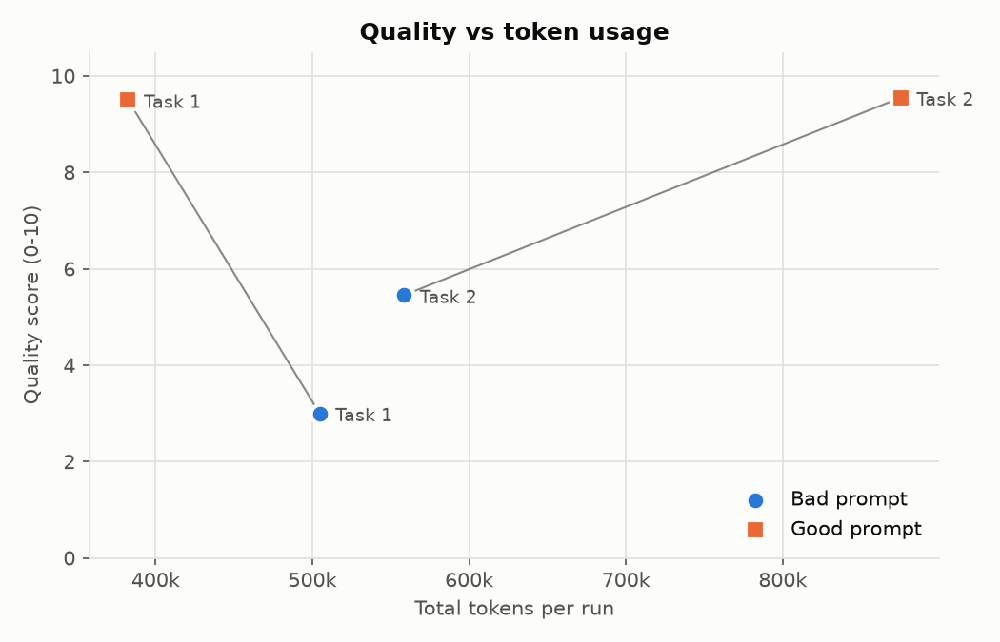
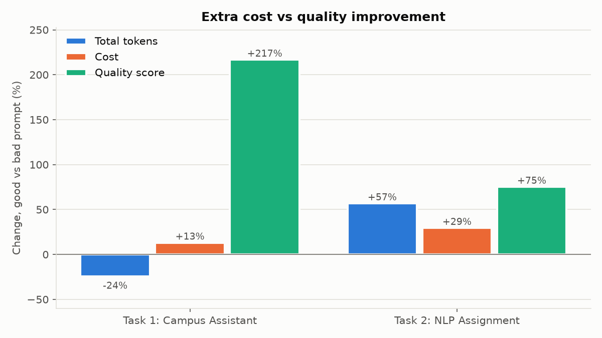

# Token Usage, Cost and Efficiency

[← Назад к README](../README.md) · [Задача 1](task-1-campus-assistant.md) · [Задача 2](task-2-nlp-assignment.md)

Этот раздел сравнивает Bad Prompt и Good Prompt не только по качеству, но и по расходу токенов, стоимости и времени. Все числа токенов взяты из реальных полей `usage`, которые API Anthropic вернул на каждый запрос во время экспериментов. Ничего не оценивалось «на глаз».

## Сколько экспериментов

В задании упоминаются **23 эксперимента**, но в этом репозитории их проведено **2**: Задача 1 (SDU Campus Assistant) и Задача 2 (NLP Assignment 2). В каждом один запуск Bad Prompt и один запуск Good Prompt, всего **4 запуска**. Данных о других 21 эксперименте нет, поэтому вся статистика ниже посчитана по 2 экспериментам. Пропуски я не заполнял выдуманными цифрами.

## Как измерялось

| Что | Откуда | Статус |
|---|---|---|
| Input / Output / Cache tokens | Поля `usage` каждого запроса к API в транскриптах агентов: `input_tokens`, `cache_creation_input_tokens` (разбивка 5m / 1h), `cache_read_input_tokens`, `output_tokens`, `output_tokens_details.thinking_tokens` | **Измерено** |
| Модель, тариф | `model = claude-opus-5-5`, `service_tier = standard`, `speed = standard`, `effort = medium` — из тех же записей | **Измерено** |
| Разница токенов между промптами | Первый запрос обоих запусков одной задачи отличается только текстом промпта, поэтому разница input-токенов первого запроса — это точная разница токенов промптов | **Измерено** |
| Токены отдельно по Task / Context / Format / Example / Requirements | Нужен эндпоинт `count_tokens`, а ключа API в этой среде нет | **Not measured**, есть скрипт [`scripts/count_prompt_tokens.py`](../scripts/count_prompt_tokens.py) |
| Абсолютное число токенов самого промпта (без системной части) | Системный промпт Claude Code и описания инструментов (~48 тыс. токенов) нельзя измерить отдельно от промпта | **Not measured** (тот же скрипт) |
| Время генерации финального ответа | Разница отметок времени в транскрипте: от последнего результата инструмента до записи финального ответа | **Измерено** |
| Время всего запуска | `duration_ms` из уведомления Claude Code о завершении агента; включает работу инструментов | **Измерено** |
| Стоимость | Посчитана по формуле из измеренных токенов и официальных цен | **Рассчитано** |
| Quality Score | Рубрика из 10–11 критериев, оценки 0/1/2, с объяснением каждой оценки: [`data/quality_scores.json`](data/quality_scores.json) | **Экспертная оценка** |

**Что не входит в измерения:**
- Токены, которые Claude Code потратил на создание этого репозитория, анализ и написание файлов. Это не эксперимент.
- Скрытые системные инструкции не считаются частью пользовательского промпта. Они одинаковы для Bad и Good и входят только в строку «первый запрос: prompt + system + tools».

**Важная особенность.** Промпты выполнялись не одним вызовом API, а агентом. Агент сам читал файлы (отчёт, ноутбук, CSV) и делал несколько запросов, от 6 до 13. Поэтому есть два уровня метрик:
- **Whole run** — все запросы агента: чтение файлов, размышления, финальный ответ. Это реальный полный расход на задачу.
- **Final answer request** — только последний запрос, в котором модель написала ответ.

### Цены (official provider pricing)

Источник: [platform.claude.com/docs/en/about-claude/pricing](https://platform.claude.com/docs/en/about-claude/pricing), проверено **2026-11-12**. Модель `claude-opus-5-5`, USD за 1 млн токенов:

| Base input | Cache write 5m | Cache write 1h | Cache read | Output |
|---:|---:|---:|---:|---:|
| $4.00 | $5.00 | $8.00 | $0.20 | $20.00 |

Формула без двойного подсчёта: каждый input-токен попадает ровно в одну категорию (`input_tokens` — только некэшированный остаток):

```text
Cost = input × $4 + cache_write_5m × $5 + cache_write_1h × $8 + cache_read × $0.20 + output × $20   (всё / 1 000 000)
```

Все записи в кэш были 5-минутными (1h = 0). Запуски шли через Claude Code, а не напрямую через API, поэтому **Estimated Cost — это стоимость по публичным ценам API, а не реальный счёт**.

## 11.2. Из чего состоит Good Prompt

Схема в моих промптах — Task → Context → Format → Example. Строки-правила внутри EXAMPLE («Не придумывай…», «Сначала найди…») я выделил в отдельную часть Requirements. Format соответствует Output Format.

| Часть | Задача 1: символы / слова | Доля | Задача 2: символы / слова | Доля | Токены |
|---|---:|---:|---:|---:|---|
| Task | 152 / 22 | 13.4% | 118 / 17 | 9.9% | Not measured |
| Context | 283 / 42 | 25.0% | 405 / 63 | 33.9% | Not measured |
| Output Format (FORMAT) | 362 / 50 | 32.0% | 403 / 58 | 33.8% | Not measured |
| Example (шаблон) | 132 / 22 | 11.7% | 160 / 25 | 13.4% | Not measured |
| Requirements (правила) | 203 / 30 | 17.9% | 107 / 14 | 9.0% | Not measured |
| **Весь Good Prompt** | **1171 / 170** | 100% | **1232 / 181** | 100% | — |
| **Bad Prompt** | 215 / 30 | — | 132 / 19 | — | — |
| **Good − Bad, токены (измерено)** | | | | | **+410** (задача 1), **+463** (задача 2) |

Доля указана по символам. Больше всего места занимают **Format** и **Context**: вместе 57–68% промпта.

## 11.3. Сравнение по экспериментам

### Задача 1 — SDU Campus Assistant

| Metric | Bad Prompt | Good Prompt | Difference |
|---|---:|---:|---:|
| Model | claude-opus-5-5 | claude-opus-5-5 | — |
| Prompt length (chars / words) | 215 / 30 | 1171 / 170 | +956 / +140 |
| Prompt tokens (good − bad, measured) | — | — | +410 |
| Input tokens, first request (prompt + system + tools) | 48 188 | 48 598 | +410 |
| API requests in the run | 8 | 6 | -2 |
| Input tokens, whole run | 498 000 | 371 772 | −126 228 (−25.3%) |
| &nbsp;&nbsp;of which cache read | 428 142 | 298 196 | −129 946 |
| &nbsp;&nbsp;of which cache write (5m) | 69 842 | 73 564 | +3 722 |
| &nbsp;&nbsp;of which uncached input | 16 | 12 | −4 |
| Output tokens, whole run | 6 606 | 10 679 | +4 073 (+61.7%) |
| &nbsp;&nbsp;of which thinking | 879 | 658 | −221 |
| Output tokens, final answer request | 4 853 | 9 510 | +4 657 (+96.0%) |
| **Total tokens, whole run** | **504 606** | **382 451** | **−122 155 (−24.2%)** |
| Response length (chars / words) | 9 496 / 1 482 | 22 511 / 3 669 | +137.1% / +147.6% |
| Generation time, final answer (s) | 52.1 | 86.0 | +33.9 |
| Run wall-clock time incl. tools (s) | 126.9 | 137.2 | +10.3 |
| **Estimated cost, whole run** | **$0.5670** | **$0.6411** | **+$0.0741 (+13.1%)** |
| Estimated cost, final answer request | $0.1211 | $0.2149 | +$0.0938 |
| Cost of the whole run without caching (for reference) | $2.1241 | $1.7007 | −19.9% |
| **Quality Score (0–10)** | **3.0** (6/20) | **9.5** (19/20) | **+6.5 (+216.7%)** |
| Quality per 1 000 tokens | 0.0059 | 0.0248 | +317.8% |
| Cost per quality point | $0.1890 | $0.0675 | −64.3% |

### Задача 2 — NLP Assignment 2

| Metric | Bad Prompt | Good Prompt | Difference |
|---|---:|---:|---:|
| Model | claude-opus-5-5 | claude-opus-5-5 | — |
| Prompt length (chars / words) | 132 / 19 | 1232 / 181 | +1100 / +162 |
| Prompt tokens (good − bad, measured) | — | — | +463 |
| Input tokens, first request (prompt + system + tools) | 48 174 | 48 637 | +463 |
| API requests in the run | 7 | 13 | +6 |
| Input tokens, whole run | 549 393 | 854 920 | +305 527 (+55.6%) |
| &nbsp;&nbsp;of which cache read | 448 027 | 766 288 | +318 261 |
| &nbsp;&nbsp;of which cache write (5m) | 101 352 | 88 604 | −12 748 |
| &nbsp;&nbsp;of which uncached input | 14 | 28 | +14 |
| Output tokens, whole run | 9 003 | 20 432 | +11 429 (+126.9%) |
| &nbsp;&nbsp;of which thinking | 1 643 | 2 072 | +429 |
| Output tokens, final answer request | 5 805 | 7 810 | +2 005 (+34.5%) |
| **Total tokens, whole run** | **558 396** | **875 352** | **+316 956 (+56.8%)** |
| Response length (chars / words) | 10 080 / 1 615 | 17 380 / 2 634 | +72.4% / +63.1% |
| Generation time, final answer (s) | 58.7 | 50.2 | -8.5 |
| Run wall-clock time incl. tools (s) | 171.0 | 340.5 | +169.6 |
| **Estimated cost, whole run** | **$0.7765** | **$1.0050** | **+$0.2285 (+29.4%)** |
| Estimated cost, final answer request | $0.1488 | $0.2166 | +$0.0678 |
| Cost of the whole run without caching (for reference) | $2.3776 | $3.8283 | +61.0% |
| **Quality Score (0–10)** | **5.5** (12/22) | **9.6** (21/22) | **+4.1 (+75.2%)** |
| Quality per 1 000 tokens | 0.0098 | 0.0109 | +11.8% |
| Cost per quality point | $0.1425 | $0.1052 | −26.1% |

## 11.5. Общая статистика (2 эксперимента, 4 запуска)

| Показатель | Bad Prompt | Good Prompt | Разница |
|---|---:|---:|---:|
| Input tokens, первые запросы (prompt + system + tools) | 96 362 | 97 235 | +873 (+0.9%) |
| Input tokens, все запросы агентов | 1 047 393 | 1 226 692 | +179 299 (+17.1%) |
| Output tokens, все запросы | 15 609 | 31 111 | +15 502 (+99.3%) |
| Output tokens, только финальные ответы | 10 658 | 17 320 | +6 662 (+62.5%) |
| **Total tokens** | **1 063 002** | **1 257 803** | **+194 801 (+18.3%)** |
| Total tokens, обе версии вместе | — | — | **2 320 805** |
| Среднее Total tokens на эксперимент | 531 501 | 628 902 | +18.3% |
| **Общая стоимость** | **$1.3435** | **$1.6461** | **+$0.3026 (+22.5%)** |
| Средняя стоимость на эксперимент | $0.6718 | $0.8231 | +22.5% |
| Среднее время генерации финального ответа | 55.4 с | 68.1 с | +12.7 с (+22.8%) |
| Среднее время всего запуска (с инструментами) | 148.9 с | 238.9 с | +90.0 с (+60.4%) |
| Средний Quality Score | 4.2 | 9.5 | +5.3 (+125.4%) |

- **Самый экономный запуск:** Задача 1, Bad Prompt — $0.567. По числу токенов самый маленький запуск — Задача 1, Good Prompt (382 451 токен), потому что агенту понадобилось 6 запросов вместо 8.
- **Самый затратный запуск:** Задача 2, Good Prompt — 875 352 токена, $1.005, 340.5 с. Агент сделал 13 запросов: читал ноутбук, CSV и файлы из `outputs/`, чтобы взять реальные числа.

## 11.6. Анализ эффективности

| Метрика | Задача 1 | Задача 2 |
|---|---:|---:|
| Quality Improvement (баллы / %) | +6.5 / +216.7% | +4.1 / +75.2% |
| Token Overhead, промпт (измерено) | +410 токенов (+0.9% первого запроса) | +463 токена (+1.0% первого запроса) |
| Token Overhead, весь запуск | **−122 155 (−24.2%)** | +316 956 (+56.8%) |
| Cost Overhead, весь запуск | +$0.0741 (+13.1%) | +$0.2285 (+29.4%) |
| Quality per 1 000 tokens, Bad → Good | 0.0059 → 0.0248 (+318%) | 0.0098 → 0.0109 (+12%) |
| Cost per quality point, Bad → Good | $0.1890 → $0.0675 (−64%) | $0.1425 → $0.1052 (−26%) |
| Цена одного дополнительного балла качества | $0.0114 | $0.0557 |

**Задача 1: Good Prompt явно оправдан.** Качество выросло более чем втрое. Всего токенов стало даже меньше: точное задание («найди Sprint 5 Report», «разбери по разделам») сократило поиск по файлам с 8 запросов до 6. Ответ вырос почти вдвое (+96% output-токенов финального ответа), и из-за этого стоимость всё равно поднялась на 13%. Каждый балл качества обошёлся на 64% дешевле.

**Задача 2: Good Prompt оправдан, но выигрыш меньше.** Качество выросло на 75%, токены на 57%, стоимость на 29%. Почти весь рост токенов — это cache read (+318 тыс.): агент сделал 13 запросов вместо 7, потому что требование «используй реальные данные из ноутбука» заставило его прочитать больше файлов. Качество на 1000 токенов почти не изменилось (+12%). Стоимость балла качества снизилась на 26%, но только потому, что cache read дешёвый. Без кэширования этот запуск стоил бы на 61% дороже Bad, а не на 29%.

**Сам структурированный промпт почти ничего не стоит.** +410–463 токена — около 1% первого запроса и примерно $0.002 при записи в кэш. Расход определяется не длиной промпта, а тем, что он заставляет модель сделать: написать более длинный ответ и, в агентном режиме, прочитать больше файлов.

## 11.7. Графики

Все графики построены скриптом [`scripts/build_token_report.py`](../scripts/build_token_report.py) по данным из [`data/usage_metrics.json`](data/usage_metrics.json).













## 11.10. Итоговые ответы

1. **Всегда ли Good Prompt использует больше токенов?** Нет. В Задаче 1 весь запуск с Good Prompt потратил на 24% *меньше* токенов, потому что агенту понадобилось меньше шагов. Больше он всегда тратит только **output-токенов**: +62% (запуск задачи 1) и +127% (задача 2).
2. **Насколько увеличивается входной расход?** Сам промпт: +410 и +463 токена, около +1% первого запроса. Входные токены всего запуска зависят от поведения агента: −25% в Задаче 1 и +56% в Задаче 2.
3. **Ответы короче или длиннее?** Длиннее в обоих случаях: финальный ответ +96% и +35% output-токенов, +137% и +72% символов. Причина — FORMAT требовал больше разделов.
4. **Пропорционально ли растёт качество?** Нет. В Задаче 1 качество выросло намного больше расхода (+217% качества при +13% стоимости). В Задаче 2 рост почти пропорционален токенам (+75% качества при +57% токенов), поэтому качество на 1000 токенов почти не изменилось.
5. **В каких категориях структура эффективнее всего?** По двум экспериментам можно сказать только про эти две задачи. Сильнее всего структура помогла там, где нужен **конкретный результат для использования**: речь на английском, план защиты, вопросы с ответами (Задача 1). Там, где модель и без структуры дала содержательный разбор (Задача 2), выигрыш меньше. Для обобщения по категориям нужно больше экспериментов.
6. **Какой вариант экономически выгоднее?** В абсолютных деньгах дешевле Bad Prompt: $1.34 против $1.65 за оба эксперимента. В пересчёте на качество выгоднее Good Prompt: балл качества дешевле на 64% и 26%. С Bad Prompt для такого же результата пришлось бы писать уточняющие запросы, а это ещё запуски.
7. **Стоит ли писать подробные промпты для простых задач?** Простые задачи я не тестировал, поэтому это вывод, а не измерение. Промпт сам по себе стоит около 1% входа, но он увеличивает ответ. Если короткий ответ и так подходит, FORMAT с 7–8 пунктами сделает его длиннее и дороже без пользы.
8. **Когда дополнительные токены оправданы?** Когда результат нужно сразу использовать без доработки: формат, язык, обязательные разделы. И когда важна точность по реальным данным: правило «не придумывай» стоило лишних запросов, но убрало непроверенные цифры (см. Задачу 2).

## Ограничения

- По одному запуску на промпт. Разброс от запуска к запуску не измерен; агент мог бы прочитать другие файлы и потратить другое число токенов.
- Quality Score ставил Claude, то есть та же модель, которая писала ответы. Оценки объяснены по каждому критерию в [`data/quality_scores.json`](data/quality_scores.json), и их стоит проверить самому.
- Около 48 тыс. токенов каждого первого запроса — системный промпт Claude Code и описания инструментов. При прямом вызове API без агента расход был бы намного меньше, но такие вызовы не делались, и их стоимость здесь не измерена.

## Как воспроизвести

```bash
python scripts/analyze_usage.py <папка с транскриптами subagents>   # usage, время, стоимость -> results/data/usage_metrics.json
python scripts/build_token_report.py                                 # эффективность, таблицы, графики
python scripts/count_prompt_tokens.py                                # токены по частям промпта (нужен ANTHROPIC_API_KEY)
```

Сохранённые данные: [`data/usage_metrics.json`](data/usage_metrics.json) (все запросы по отдельности), [`data/efficiency.json`](data/efficiency.json), [`data/totals.json`](data/totals.json), [`data/quality_scores.json`](data/quality_scores.json), тексты промптов в [`../prompts/`](../prompts/), ответы в [`data/answers/`](data/answers/).
